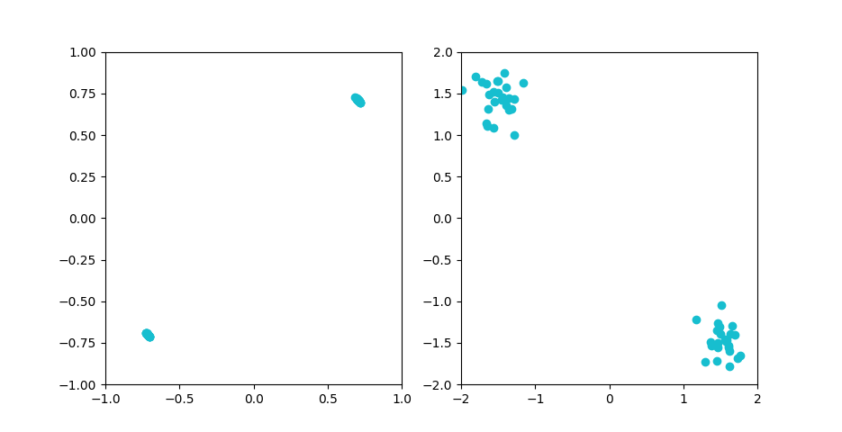
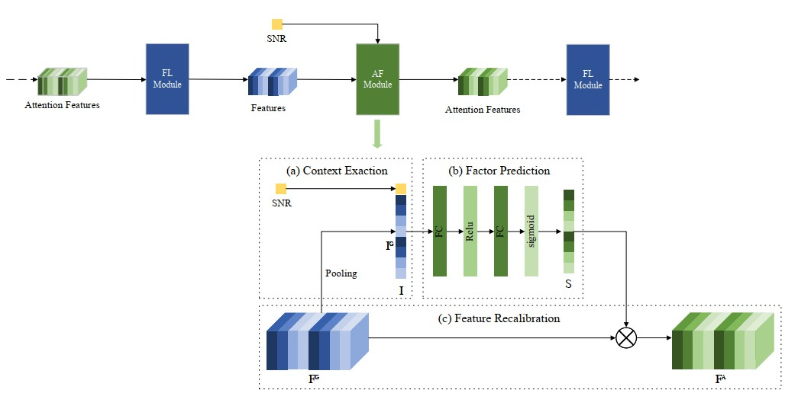
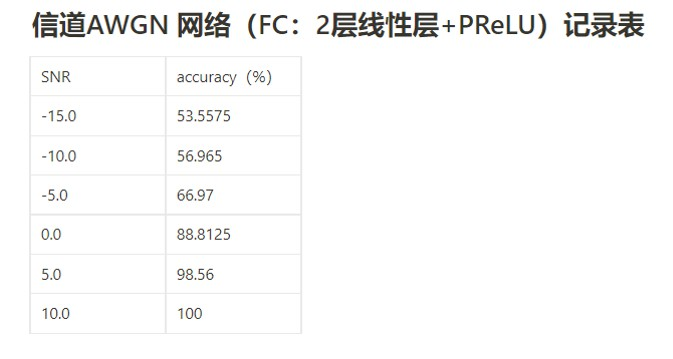
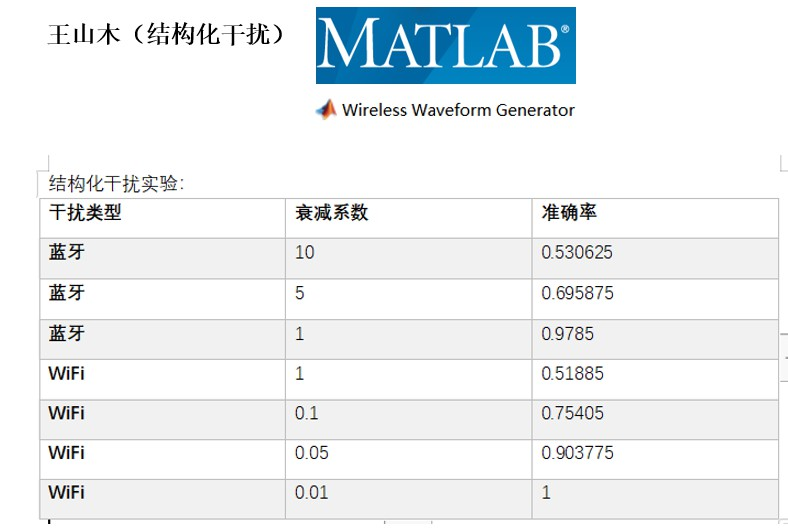
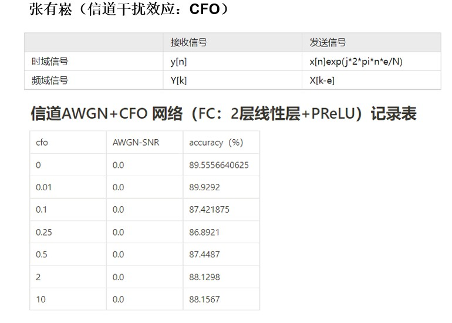
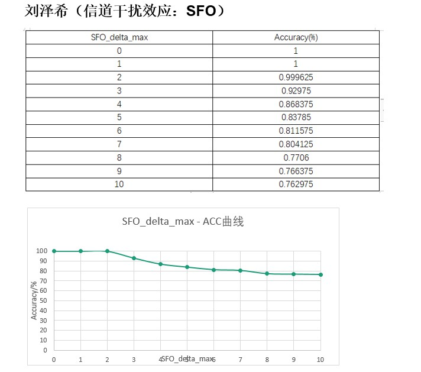
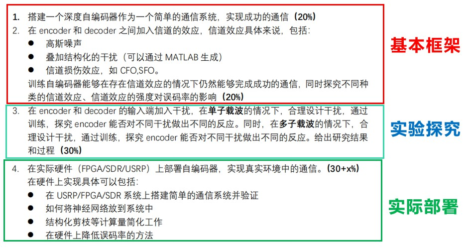
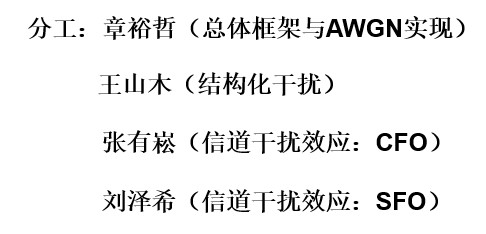

# Antiinterferencia_física_implementada_con_IA
Este es un proyecto de curso en **Principios de Comunicación Inalámbrica y Redes Móviles** (IE304 en SJTU).
Nuestro objetivo es utilizar un autoencoder para detectar la ocurrencia de perturbaciones o colisiones y evitarlas, y además realizar una tecnología completa de comunicación antiinterferencia.

## Miembros del Grupo
**YUZHE ZHANG** (líder del grupo)

**SHANMU WANG, YOUSONG ZHANG, ZEXI LIU**

**TA: MINGQI XIE**
# Todavía En Proceso

## Actualización 2022.5.17 Un tipo Un canal Situación
1. Un canal: solo 1 de 64 en *codificado* (cuyo significado físico son 64 canales de diferente frecuencia)
2. Un tipo de interferencia: Solo existe 1 patrón de interferencia estructural, que se genera en Matlab, lo que significa que el tamaño de salida de la observación también es 1.
3. Sobrescribir el modelo y corregir algunos errores. La figura de constelación de los datos codificados y la interferencia en el dominio de la frecuencia se muestra a continuación.

## Actualización 2022.4.26 Reestructurar el Marco
Reforma de un marco manipulable trivial, que incluye entrenador y canal.
Cargamos los datos del canal desde .mat y agregamos interferencia del canal sobre ellos.

Y todavía estamos trabajando en agregar el módulo AF.
## Actualización 2022.4.10 Objetivo de la Próxima Etapa
Después de que se ha implementado el módulo base del autoencoder y varios canales, necesitamos agregar módulos de detección de canal y retroalimentación apropiados a nuestro trabajo.

Después de estudiar trabajos relacionados, encontramos un artículo ***Wireless Image Transmission Using Deep Source Channel Coding With Attention Modules***, que propone aprovechar algunos módulos AF. Nos esforzaremos por mejorar el trabajo existente bajo la guía de la siguiente ilustración.

## Actualización 2022.3.30 Algunos resultados experimentales ##
Aquí hay algunas muestras de los resultados experimentales recientes.

#### 1.Figura1. Precisión bajo AWGN de diferente SNR

#### 2.Figura2. Precisión bajo Daño Estructural

#### 3.Figura3. Precisión bajo CFO

#### 4.Figura4. Precisión bajo SFO
 

## Actualización 2022.3.1 División de Tareas y Realización Inicial##
El cronograma objetivo y la distribución del trabajo de nuestro proyecto en la primera etapa se muestra a continuación.

## Actualización 2022.2 Distribución del trabajo

